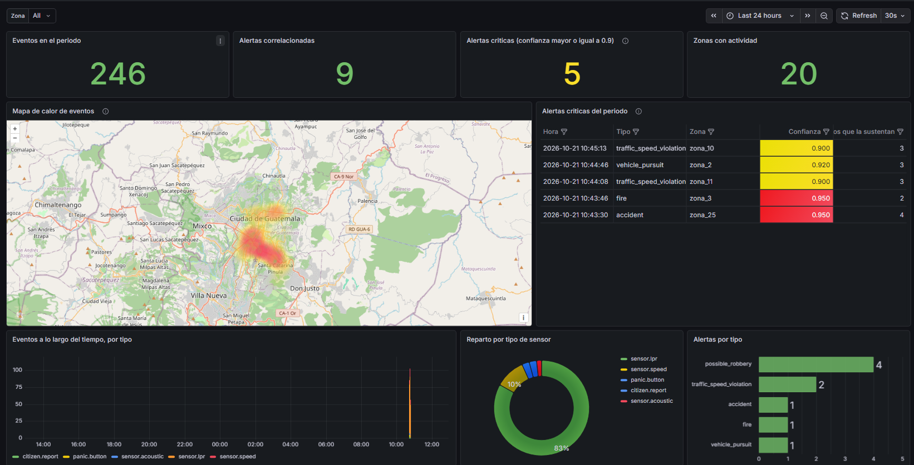
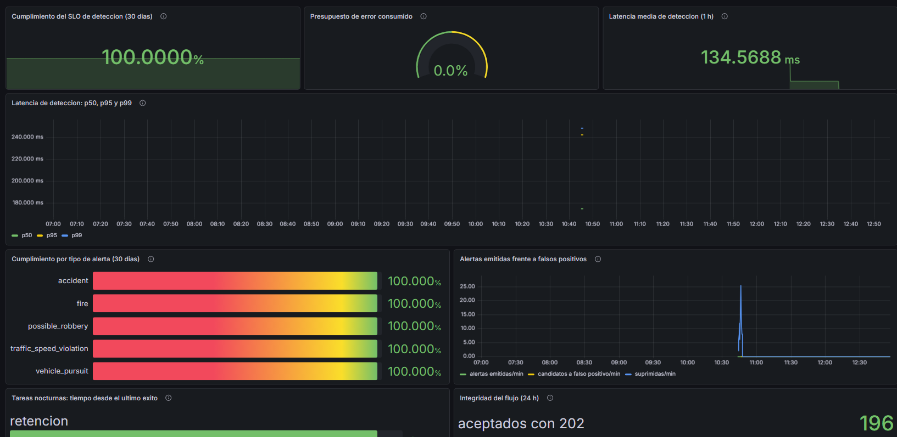
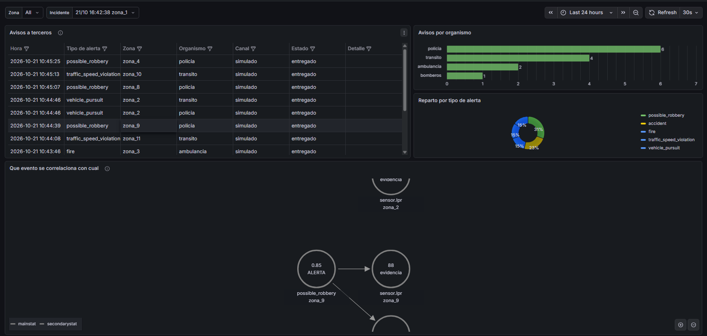
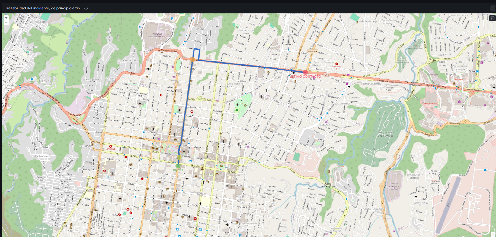

# Introducción

La seguridad ciudadana de una capital genera un volumen de señales que ningún operador humano puede vigilar simultáneamente. Cámaras de lectura de placas, botones de pánico, sensores de velocidad, micrófonos y reportes de ciudadanos producen, cada uno por su lado, datos que aisladamente dicen poco. Una placa que pasa a 85 km/h no es un delito. Un botón de pánico pulsado puede ser un error. Un sonido de vidrio roto puede ser un accidente doméstico. Los tres juntos, en la misma zona y dentro del mismo minuto, son un robo en curso.

Ese salto de señales sueltas a incidentes con significado es el problema que aborda este proyecto. No es un problema de sensores: es un problema de arquitectura.

<!-- salto -->

## Planteamiento del problema

La Municipalidad de Ciudad de Guatemala, cliente hipotético que nuestro grupo declara atender, opera una capital de área metropolitana extensa con un equipo de sistemas reducido. Enfrenta tres restricciones que condicionan cualquier solución técnica.

La primera es de disponibilidad: la detección de incidentes de seguridad no puede depender de un enlace a internet. Un corte de conectividad no puede traducirse en una ciudad que deja de ver lo que ocurre en sus calles.

La segunda es de legalidad: las placas vehiculares y las coordenadas geográficas son datos personales. Aunque en este proyecto sean sintéticos, tratarlos como si no lo fueran invalidaría el ejercicio, porque una institución pública guatemalteca está obligada por el Decreto 57-2008 a proteger los datos personales que custodia.

La tercera es de sostenibilidad operativa: el sistema lo heredará un equipo pequeño. Toda complejidad que se introduzca hoy se paga todos los meses durante años.

<!-- salto -->

## Objetivos

### Objetivo general

Diseñar, justificar y construir una simulación funcional de una plataforma de monitoreo perimetral urbano basada en arquitectura distribuida orientada a eventos, de modo que cada decisión técnica relevante quede respaldada por un análisis de alternativas defendible ante actores no técnicos.

### Objetivos específicos

- Implementar una arquitectura de microservicios capaz de ingerir, validar, correlacionar, archivar e indexar eventos urbanos heterogéneos en tiempo real.
- Definir y verificar un objetivo de nivel de servicio cuantitativo para la latencia de detección, junto con la política de actuación cuando se incumpla.
- Registrar como *Architecture Decision Record* cada decisión de arquitectura costosa de revertir, con sus alternativas y sus consecuencias.
- Establecer una frontera de privacidad explícita que impida que datos identificables de ciudadanos salgan del control municipal.
- Evaluar el comportamiento del sistema ante picos de carga, ante la caída de un componente y ante el paso del tiempo sobre el archivo histórico.

## Alcance y limitaciones

El alcance es una simulación lógica. No se emplean dispositivos físicos de adquisición: los cinco tipos de sensor urbano se emulan programáticamente con un generador de carga escrito para este proyecto. Esta es una condición del enunciado, no una concesión.

Dentro del alcance quedan la ingesta, la validación contra contrato, la deduplicación, la correlación en ventanas temporales, la generación de alertas, el registro del aviso a los organismos de respuesta, la trazabilidad de cada alerta hasta los eventos que la sustentan, el archivado estructurado, la indexación para búsqueda histórica, la retención de datos, la observabilidad y la visualización.

Fuera del alcance quedan la entrega real de los avisos a bomberos, ambulancia, policía y tránsito (el sistema decide a quién avisar y lo registra, pero ninguna llamada ni mensaje sale hacia esos organismos), el reconocimiento de imágenes, cualquier forma de aprendizaje automático sobre los eventos, y la infraestructura física de red. Las limitaciones técnicas concretas que el sistema conserva se enumeran sin adornos en la sección Limitaciones y trabajo futuro.

<!-- salto -->

# Ciudades inteligentes: referentes y comparación

Las plataformas de ciudad inteligente orientadas a seguridad comparten una misma forma: muchos productores heterogéneos, un transporte de eventos común, un motor que correlaciona y un centro donde alguien decide. Lo que las diferencia es dónde ponen el centro de gravedad: en la sala de control, en la plataforma de datos abiertos, o en la capacidad analítica.

## Centro de Operaciones do Rio de Janeiro

El referente más citado en la región es el Centro de Operaciones de Río de Janeiro, inaugurado en 2010 y construido con IBM, que integró en una sola sala de control a decenas de dependencias municipales que antes operaban por separado. Su centro de gravedad es organizativo antes que técnico: el logro principal fue poner a los responsables de tránsito, defensa civil, salud y policía a mirar la misma pantalla.

De ahí se tomó una idea y se descartó otra. Se tomó la noción de incidente como unidad de trabajo: lo que llega al operador no es un evento sino una correlación ya interpretada, con su evidencia adjunta. Se descartó la dependencia de una sala física permanentemente atendida; este sistema asume que nadie está mirando y por eso invierte en alertas automáticas que buscan a la persona.

La literatura crítica sobre Río también deja una advertencia que se tomó en serio: una plataforma de este tipo concentra capacidad de vigilancia sobre la población, y esa concentración exige contrapesos explícitos.

## Barcelona y la plataforma Sentilo

Barcelona desarrolló Sentilo, una plataforma de sensores publicada como software libre, construida sobre un modelo de publicación y suscripción con un catálogo explícito de sensores y sus tipos de dato. Su centro de gravedad es el contrato: el valor no está en el motor sino en que cualquier proveedor pueda conectar un sensor nuevo sin tocar la plataforma.

Esa es la idea que más influyó en este proyecto. El evento canónico versionado que se describe más adelante, publicado por los propios servicios en `/events/schema`, cumple exactamente esa función: un productor nuevo se integra leyendo el contrato, no leyendo el código.

## Singapur

El programa Smart Nation de Singapur, iniciado en 2014, opera a una escala y con un presupuesto que no admiten comparación directa con el caso que aquí se atiende. Su aporte al análisis es por contraste: es el ejemplo de la arquitectura que este proyecto conscientemente no construyó. Donde Singapur puede permitirse una plataforma nacional con elasticidad ilimitada y equipos dedicados, la Municipalidad de Guatemala necesita un sistema que un equipo reducido pueda operar.

Copiar la arquitectura de un referente sin copiar su contexto es el error que este proyecto trata de evitar al declarar explícitamente el cliente antes de decidir nada.

## El contexto guatemalteco

La Municipalidad de Guatemala ya opera infraestructura de monitoreo urbano videovigilancia y gestión de tránsito a través de la Empresa Metropolitana Reguladora de Transporte y Tránsito lo que significa que este sistema no llegaría a un vacío sino a un entorno con sistemas previos. Esa constatación tiene una consecuencia de diseño concreta: la vía de integración es el contrato de eventos, no la sustitución de lo existente. Un sistema previo se integra publicando en el ingestor, sin que nada más cambie.

:::tabla Comparación de referentes por centro de gravedad arquitectónico
| Referente | Centro de gravedad | Qué se tomó | Qué se descartó |
|---|---|---|---|
| Río de Janeiro (COR) | Sala de control integrada | El incidente correlacionado como unidad de trabajo | La dependencia de vigilancia humana permanente |
| Barcelona (Sentilo) | Contrato de sensores | Evento canónico versionado y publicado | El catálogo centralizado de dispositivos |
| Singapur (Smart Nation) | Escala y analítica nacional | Nada directamente | La arquitectura elástica de presupuesto abierto |
| Este proyecto | Autonomía del camino crítico | — | — |
:::

## Qué distingue a esta propuesta

Ninguno de los referentes anteriores declara como propiedad de diseño que la detección sobreviva a un corte de internet. En arquitecturas construidas para ciudades con conectividad redundante, esa propiedad se da por supuesta. Aquí no puede suponerse, y por eso se convirtió en el criterio que ordena todas las demás decisiones: el camino crítico completo ingesta, transporte, correlación y alerta se ejecuta dentro de la red municipal, y solo el archivo histórico y la analítica cruzan hacia la nube.

<!-- salto -->

# Arquitectura propuesta

## Modelo de despliegue híbrido

El sistema se despliega en dos capas con una frontera explícita, documentada dentro del mismo proyecto.

:::imagen Esquemático de infraestructura: nodos, servicios y segmentos de red
../diagramas/infraestructura.png
:::

La propiedad central es verificable con una sola pregunta: ***¿qué deja de funcionar si se cae el enlace?*** La respuesta es el archivo histórico y los tableros, que se ponen al día solos al volver. La detección de incidentes continúa.

Esa propiedad no se obtiene sola, y el diseño ingenuo la pierde. Si el servicio de ingesta escribiera en la base de datos de forma síncrona antes de responder que es la forma natural de escribirlo un corte del enlace detendría la ingesta por completo. Conservarla exigió extraer la persistencia a servicios propios que consumen de Kafka de forma asíncrona, y es la decisión estructural más importante de esta arquitectura.

## ¿Por qué híbrido, y por qué la frontera está donde está?

Un modelo íntegramente contratado por internet no exige inversión inicial, pero cuesta del orden de 800 a 2 000 dólares mensuales y deja la detección de incidentes al otro lado de un enlace que puede caerse. Un modelo íntegramente propio exige entre 20 000 y 35 000 dólares de inversión y personal técnico que la Municipalidad no tiene para operar la búsqueda histórica y renovar discos. El híbrido queda en 8 000 a 16 000 dólares de inversión y de 360 a 900 mensuales, y resulta más económico que el contratado a partir del segundo año. Son cifras de orden de magnitud, no una cotización.

La frontera no se trazó por comodidad: se aplicaron dos preguntas a cada componente. ¿Participa en el camino que va del evento a la alerta, cuyo objetivo es de dos segundos? ¿Crece sin límite? Lo que responde que sí a la primera permanece en la red municipal. Lo que responde que sí solo a la segunda puede salir.

Permanecen en la red municipal:

- **Ingestor, Kafka, Redis y correlator.** Son el camino crítico. Dentro de la red local el recorrido completo se estimó en 30 a 100 milisegundos, un orden de magnitud por debajo del objetivo, porque ningún tramo cruza el enlace. Colocar cualquiera de ellos en la nube haría que cada corte de internet detuviera la detección en una ciudad de tres millones de habitantes.
- **Persister, indexer y jobs.** Son los que cruzan la frontera. Leen de Kafka dentro de la red local y escriben hacia la nube por lotes, de modo que el costo de la ida y vuelta se paga una vez cada cien eventos y no una por evento. Si el enlace cae, Kafka retiene los eventos 72 horas y las alertas 7 días, y el archivo se pone al día solo al volver.
- **Prometheus y Grafana.** El recolector de métricas abre conexiones hacia cada servicio; desde la nube serían conexiones de entrada a la red municipal, que es justo lo que este modelo excluye. Además, cuando el enlace cae es cuando más hacen falta las métricas, y un recolector al otro lado quedaría ciego.

A la nube van únicamente PostgreSQL gestionada y Elasticsearch con Kibana. Es el único componente cuyo tamaño no está acotado por el número de sensores, porque el archivo crece entre 60 y 90 gigabytes al mes. No participa en la detección y tolera el retraso, porque Kafka lo absorbe. Y es lo que más conviene delegar: operar un buscador, hacer respaldos y renovar almacenamiento es trabajo permanente que un servicio gestionado hace por el cliente. PostgreSQL acompaña a Elasticsearch por el mismo criterio, ya que ambos son archivo y no detección; dejar uno de los dos en casa habría obligado a la Municipalidad a mantener respaldos y discos sin ganar nada en continuidad.

La frontera tuvo además una consecuencia que no estaba planeada: coincide con el lugar donde debe protegerse el dato personal. La placa viaja en claro dentro de la red municipal, donde la correlación la necesita, y se convierte en un seudónimo irreversible justo antes de cruzar. Quien obtuviera la base completa en la nube no podría recuperar una sola placa.

El costo de esta decisión es un servicio más que operar y dos entornos que mantener.

## Los seis microservicios

:::tabla Microservicios, responsabilidad y dependencia del enlace
| Servicio | Puerto | Responsabilidad | ¿Depende del enlace? |
|---|---|---|---|
| **ingestor** | 8000 | Valida contra contrato, enriquece, deduplica y publica en Kafka | No |
| **correlator** | 8080 | Mantiene ventanas en Redis, evalúa reglas y emite alertas | No |
| **persister** | 8002 | Archiva eventos y alertas en PostgreSQL por lotes | Sí |
| **indexer** | 8003 | Indexa en Elasticsearch por lotes, un índice por mes | Sí |
| **jobs** | 8004 | Agregados diarios y aplicación de la política de retención | Sí |
| **notifier** | 8005 | Decide a qué organismos avisar de cada alerta y deja constancia del aviso; la entrega es simulada | Sí |
:::

Cada servicio es un módulo Go independiente, con sus propias dependencias y su propio ciclo de compilación. No comparten una sola línea de código, compartir una biblioteca habría obligado a redesplegar los seis ante cualquier cambio, que es exactamente la propiedad que un microservicio debe evitar.

## Recorrido de un evento

El recorrido completo, desde que un sensor simulado emite hasta que la alerta está disponible, atraviesa siete etapas.

1. El productor envía el evento por `POST /events` con una clave de API. El ingestor valida el JSON crudo contra el esquema del contrato, de modo que un campo desconocido se rechace en lugar de descartarse en silencio.
2. El ingestor completa los campos que el productor omitió identificador, marca de tiempo, clave de partición y registra cuáles tuvo que completar, porque un productor que sistemáticamente omite un campo es un defecto que conviene ver.
3. Reserva el identificador del evento en Redis con una operación atómica. Si ya existía, responde `409` sin publicar: el reintento de un productor no duplica el evento.
4. Publica en el topic `events.standardized` con confirmación de todas las réplicas, particionando por zona geográfica, y solo entonces responde `202`.
5. El correlator consume, inserta el evento en la ventana de su zona (un conjunto ordenado de Redis cuya puntuación es la marca de tiempo) y evalúa las cuatro reglas de zona. Si el evento trae placa, lo inserta además en una segunda ventana indexada por el seudónimo del vehículo y evalúa la regla de persecución. Si alguna regla se cumple y no hay una alerta equivalente vigente, emite la alerta.
6. El persister y el indexer consumen el mismo flujo con grupos de consumo independientes y escriben por lotes en PostgreSQL y Elasticsearch, tokenizando la placa antes de que el dato salga de la red municipal.
7. El notifier consume las alertas del topic correlated.alerts, determina a qué organismos corresponde avisar según el tipo de alerta y registra cada aviso en PostgreSQL, sin duplicarlo si Kafka reentrega la alerta.

El identificador de trazabilidad entra por la cabecera `X-Trace-Id`, viaja en las cabeceras del mensaje de Kafka y aparece en el registro de los seis servicios, de modo que un solo identificador reconstruye el recorrido completo de cualquier evento.

## Aviso a los organismos de respuesta

Detectar un incidente no basta: hay que saber a quién corresponde atenderlo. El notifier consume las alertas de Kafka y aplica una matriz de despacho que fija, para cada tipo de alerta, qué organismos deben ser avisados (ADR-011):

- **Incendio:** bomberos y ambulancia.
- **Accidente:** ambulancia, policía y tránsito.
- **Posible robo:** policía.
- **Exceso de velocidad:** tránsito.
- **Persecución de un vehículo:** policía y tránsito.

Cada aviso queda registrado en PostgreSQL con su organismo, su canal, su estado y su hora. Una restricción de unicidad por alerta y organismo hace que la reentrega de una alerta por parte de Kafka no duplique el aviso: la idempotencia vive en la base de datos y no en el código. Si el contrato de una alerta es inválido, el mensaje va a la cola de fallidos, y si la base no responde no se confirma el offset, con el mismo criterio que el resto de los servicios de salida.

Hay que decir sin adornos que la entrega está simulada. El canal por defecto anota el aviso y escribe en el registro, y nadie acude. Existe una interfaz de canal con una implementación por webhook, apagada por defecto, para que la extensión sea demostrable, pero no hay integración con ningún cuerpo de respuesta real. Lo que sí está completo es la trazabilidad: de cada alerta puede consultarse a quién se avisó, cuándo y con qué resultado.

## Recorridos por calle

Un recorrido dibujado en línea recta entre dos puntos no es defendible, porque un coche no cruza las manzanas. Para que el trayecto de un vehículo se lea como en un mapa, el sistema calcula la ruta por las calles con OSRM, un motor de rutas de código libre que trabaja sobre el mapa de Guatemala de OpenStreetMap y corre en la capa local (ADR-012). El cálculo no lo hace el correlator, que no debe esperar a un motor externo, sino el servicio jobs, cada minuto.

Solo se traza el recorrido de las alertas que tienen un botón de pánico y exactamente un vehículo implicado; en los demás casos el tablero indica que no aplica, en lugar de inventar una ruta. El trazado parte del momento del pánico y recoge únicamente las lecturas posteriores, y se recalcula cuando el rastro crece. El resultado se guarda, incluidos los fracasos, para no reintentar sin fin. En Grafana el mapa marca el INICIO y el ÚLTIMO CONTACTO del recorrido.

## El contrato como frontera

El evento canónico versión 1.0 es un esquema JSON que define diez campos obligatorios y cierra el objeto a campos desconocidos. Vive una sola vez en el repositorio y cada servicio embebe su copia en el binario en tiempo de compilación.

No es una biblioteca compartida, y esa distinción es deliberada. Una biblioteca acopla el despliegue; un esquema acopla solo el formato. Cada servicio define sus propios tipos internos con los campos que necesita: el ingestor necesita el evento completo para validarlo, mientras que el correlator solo lee los campos que sus reglas consultan. El riesgo de que las copias diverjan se controla con una comprobación automática que forma parte de la verificación obligatoria del proyecto.

## Diseño de infraestructura

:::tabla Distribución por nodos y segmentos de red
| Nodo | Segmento | Componentes | Sistema operativo |
|---|---|---|---|
| A | LAN municipal | Kafka (KRaft), Redis | Ubuntu Server 22.04 |
| B1 · B2 · B3 | LAN municipal | ingestor · correlator · persister, indexer, jobs, notifier | Ubuntu Server 22.04 |
| **E** | LAN municipal | Prometheus, Grafana | Ubuntu Server 22.04 |
| C | Nube (VPC) | PostgreSQL gestionado, Elasticsearch | Gestionado / Linux |
| F | Nube (VPC) | Kibana | Gestionado / Linux |
| D | Estaciones de trabajo | Generador de carga y productores simulados | Windows / Linux |
:::

La ubicación del nodo E merece explicación, porque es contraintuitiva: la observabilidad suele situarse junto a la analítica, en la nube. Aquí vive en la LAN por dos razones.

La primera es de seguridad. Recolectar métricas exige que el recolector abra conexiones hacia cada servicio. Con Prometheus en la nube, esas serían conexiones de nube hacia la red municipal, es decir tráfico de entrada, que es precisamente lo que este modelo excluye. Todo lo que cruza la frontera debe ser de salida.

La segunda es de utilidad. Si el enlace se cae, la detección sigue funcionando, y es justo entonces cuando hacen falta las métricas y las alertas. Un recolector al otro lado del enlace se queda ciego en el único momento en que importa.

Grafana lo acompaña porque consulta a Prometheus, y separarlos reintroduciría el mismo tráfico de entrada. Sus paneles de PostgreSQL y Elasticsearch sí cruzan la frontera, pero como consultas puntuales de salida: durante un corte esos paneles quedan en blanco y los de tiempo real siguen vivos, que es la degradación correcta.

La segmentación es la que hace verificable la afirmación de disponibilidad: si se filtra todo el tráfico de salida del segmento A–B, el sistema debe seguir generando alertas. Esa es la prueba que se ejecutó y cuyos resultados se reportan más adelante.

# Justificación técnica: las decisiones de arquitectura

## Las doce decisiones

:::tabla Registro de decisiones de arquitectura
| ADR | Decisión | Alternativa principal descartada |
|---|---|---|
| 001 | Plataforma híbrida: LAN municipal más nube | Cloud-native íntegro |
| 002 | Go como lenguaje, por decisión del equipo | Java con Spring Boot |
| 003 | Monorepo con un módulo independiente por servicio | Módulo único compartido |
| 004 | Kafka en modo KRaft, sin Zookeeper | RabbitMQ |
| 005 | PostgreSQL relacional más Elasticsearch | Base de series de tiempo |
| 006 | Cola de mensajes fallidos y confirmación manual de offsets | Reintento indefinido |
| 007 | Seudonimización HMAC en la frontera LAN–nube | Cifrado reversible en la nube |
| 008 | SLO cuantitativo con presupuesto de error | Tableros sin umbral |
| 009 | Planificador propio en lugar de Apache Airflow | Adoptar Airflow |
| 010 | Docker Compose, sin Kubernetes | Kubernetes gestionado |
| 011 | Servicio propio de aviso a terceros, con registro de despacho | Vista derivada, sin componente nuevo |
| 012 | Recorridos por calle con OSRM en la capa de borde | Dibujar la línea recta entre puntos |
:::

## La decisión que ordena a todas las demás

El ADR-001 declara el cliente antes de decidir la plataforma, y ese orden no es retórico. La pregunta *"¿LAN, híbrido o nube?"* no tiene respuesta sin saber quién paga y qué no puede permitirse que falle.

Declarado el cliente una capital con equipo reducido, con datos personales bajo custodia y sin enlace redundante garantizado el razonamiento se vuelve casi mecánico. Un modelo íntegramente en la nube pone la detección de incidentes al otro lado de un enlace que puede caerse. Un modelo íntegramente local obliga a la Municipalidad a operar Elasticsearch y a dimensionar hardware para un crecimiento de archivo de decenas de gigabytes mensuales. El modelo híbrido permite que lo urgente sea local y lo voluminoso sea remoto.

La consecuencia más interesante de esa decisión es que definió por sí sola dónde debía ir la frontera de privacidad, según se explica más abajo.

## Por qué Go y no Java con Spring Boot

La elección de lenguaje es de las más caras de revertir, porque cambiarlo equivale a reescribir el sistema (ADR-002). Conviene decir primero algo que la presentación del proyecto dejó claro: para este sistema habrían servido varios lenguajes. Con un volumen de decenas de eventos por segundo, Java con Spring Boot, Python o Node.js pueden ingerir, correlacionar y archivar los eventos con holgura. Java cuenta además con el cliente de Kafka más maduro, con productor idempotente completo, y permite confirmar los offsets manualmente. Las decisiones que hacen correcto este sistema salen de razonar el dominio y se habrían tomado igual en cualquier lenguaje.

La razón por la que se eligió Go es del equipo y no del problema: ninguno de nosotros había programado en ese lenguaje y el proyecto era una buena oportunidad para aprenderlo. Otros lenguajes nos habrían dado un camino más corto y con menos tropiezos, y lo sabíamos; elegimos el más difícil a propósito. Un proyecto de curso produce el sistema y también lo que el equipo aprende al construirlo, y quisimos que eso incluyera un lenguaje nuevo y muy usado en infraestructura: están escritos en Go varios de los programas que usamos en este mismo proyecto, como Prometheus, Grafana y Docker. Es una razón válida para un proyecto académico. Para un cliente que paga por un sistema, la elección natural habría sido el lenguaje que el equipo ya domina.

Al usarlo encontramos ventajas que no fueron la causa de la elección, pero que hacen razonable defenderla:

- **Un binario por servicio, sin runtime externo.** Imágenes de 22 a 29 MB, memoria residente de 13 a 18 MB y arranque en milisegundos, frente a los 257 MB que ocupa una imagen base de Java antes de añadir la aplicación. Es una diferencia real, pero a este volumen no es decisiva.
- **Una concurrencia que encaja con el problema.** El persister acumula un lote mientras vence un temporizador y atiende una señal de apagado con tres goroutines y un `select`.
- **Pocas dependencias y las mismas herramientas para todos.** Entre tres y siete bibliotecas directas por servicio, y herramientas de serie (`gofmt`, `go vet` y las pruebas) que dan a todo el equipo las mismas reglas de formato y de verificación.

También tuvo costos, que se aceptaron de forma explícita:

- **Sin productor idempotente.** La biblioteca de Kafka elegida (`segmentio/kafka-go`) no lo implementa por completo, y la alternativa (`confluent-kafka-go`) depende de una librería en C que habría eliminado el binario estático. Se compensó con idempotencia en el consumidor, que protege además contra reprocesos por rebalanceo o reinicio. Con Java no habría hecho falta.
- **Tiempo.** Aprender el lenguaje y escribir lo que Spring habría dado resuelto (configuración, middleware HTTP y registro de métricas, unas cuatrocientas líneas) consumió tiempo que pudo ir a la documentación.
- **Riesgo de continuidad.** Si quien herede el sistema conoce Java y no Go, hay un costo de adopción. Se mitigó sin usar framework y con contratos que son esquemas JSON y no bibliotecas, de modo que un servicio puede reescribirse en otro lenguaje, de a uno y sin tocar a los demás (ADR-003).

## Transporte y resiliencia

Kafka se eligió sobre RabbitMQ por una razón que no es el rendimiento: para el volumen estimado, ambos bastan. La razón es la reproducción del histórico. Como la persistencia se sacó del camino crítico, el persister y el indexer consumen de forma asíncrona, y que puedan recuperar su retraso tras una caída es una propiedad central del diseño. RabbitMQ descarta el mensaje al entregarlo; recuperar ese retraso exigiría construir a mano un mecanismo de reintento.

Sobre ese transporte, el ADR-006 define qué hacer cuando algo falla, y la decisión clave es clasificar los fallos en dos tipos:

- Un fallo permanente un mensaje que no cumple el contrato, un campo imposible de interpretar no mejora con reintentos. El mensaje se envía a la cola de fallidos y se confirma el offset, para que un solo mensaje corrupto no bloquee el flujo indefinidamente.
- Un fallo transitorio la base no responde, la red falla se reintenta sin confirmar el offset, de modo que al recuperarse el consumidor retome exactamente dónde estaba.

Confundir ambos casos produce los dos peores comportamientos posibles: perder eventos válidos o detener el sistema por uno inválido.

## Privacidad

El ADR-007 parte de una constatación incómoda: una placa vehicular con marca de tiempo y coordenadas es un dato personal, y permite reconstruir los desplazamientos de una persona identificable. Que en este proyecto sean sintéticos no cambia el ejercicio de defensa.

La decisión fue seudonimizar la placa con HMAC-SHA256 exactamente en la frontera hacia la nub**e**. El mensaje de Kafka conserva el valor en claro porque el broker vive dentro de la red municipal; los dos servicios que cruzan la frontera persister e indexer tokenizan antes de escribir.

Que el punto de corte del modelo híbrido coincidiera con el punto donde debe aplicarse la protección no fue planificado: fue una consecuencia afortunada de haber sacado la persistencia del camino crítico. Una vez advertida, se convirtió en un argumento adicional a favor de esa arquitectura.

Dos detalles de implementación resultaron decisivos. El primero es que ambos servicios deben usar la misma llave: si difirieran, el mismo vehículo tendría seudónimos distintos en cada destino y las búsquedas cruzadas fallarían en silencio. El segundo es que la tokenización normaliza el formato antes de calcular, de modo que `abc-123` y `ABC123` produzcan el mismo seudónimo; sin esa normalización, el vehículo dejaría de ser correlacionable.

La llave nunca se versiona y se custodia dentro de las instalaciones municipales. Esa es la propiedad que hace que la operación sea irreversible desde la nube: quien obtenga la base de datos completa no puede recuperar una sola placa.

## Lo que se decidió no hacer

Tres decisiones son negativas, y conviene señalarlas porque son las que más probablemente se cuestionen.

**No se adoptó Kubernetes** (ADR-010). Resuelve bien el escalado automático, la reprogramación entre muchos nodos y el despliegue sin interrupción. Este sistema tiene uno y medio de esos tres problemas: una sola instancia de cada servicio absorbió el doble del volumen esperado, y el despliegue en dos nodos no da margen real de reprogramación. Lo que sí exigiría es una superficie operativa permanente sobre un equipo reducido.

**No se adoptó Apache Airflow** (ADR-009). La pregunta previa a esa decisión fue cuánto trabajo periódico necesita realmente el sistema, y la respuesta redujo el caso a la mitad. Los chequeos de salud los cubre mejor la observabilidad; la limpieza de claves la resuelven los propios tiempos de vida; y la tarea que más naturalmente pediría un orquestador copiar periódicamente los eventos hacia Elasticsearch desapareció al sustituirla por un consumidor de Kafka, que además elimina hasta una hora de retraso en la búsqueda. Quedan dos tareas nocturnas, y dos tareas nocturnas no justifican el costo operativo de un orquestador.

**No se adoptó una base de series de tiempo** (ADR-005). El enunciado la plantea explícitamente como alternativa, y la conclusión honesta es que su ventaja principal —consultas agregadas eficientes sobre ventanas temporales ya la aporta Elasticsearch en esta arquitectura. Añadirla supondría un tercer motor de almacenamiento que operar sin resolver un problema que estuviera abierto.

# Simulación de sensores urbanos

:::tabla Tipos de sensor simulados y su carga útil
| Tipo de evento | Sensor urbano | Campos característicos |
|---|---|---|
| `panic.button` | Botón de pánico ciudadano | tipo de alerta, identificador de dispositivo, contexto de usuario |
| `sensor.lpr` | Cámara de lectura de placas | placa vehicular, velocidad estimada. |
| `sensor.speed` | Sensor de velocidad o movimiento anómalo | velocidad detectada, orientación, identificador de sensor |
| `sensor.acoustic` | Sensor acústico | tipo de sonido, nivel de decibelios, probabilidad de evento crítico |
| `citizen.report` | Reporte ciudadano vía aplicación | tipo de evento, mensaje descriptivo, origen |
:::nota Todos comparten los campos comunes del evento canónico: identificador, versión, productor, origen, marca de tiempo, clave de partición, zona, coordenadas y severidad.
:::

:::tabla Escenarios del generador de carga
| Escenario | Qué ejercita |
|---|---|
| `sostenido` | Ritmo constante configurable, para medir el comportamiento en régimen |
| `rafaga` | Calentamiento, pico de 100 ev/s durante 10 s y recuperación |
| `alertas` | Las secuencias que disparan cada uno de los cuatro tipos de alerta |
| `bulk` | El contrato del endpoint de lotes |
| `enunciado` | Los dos renglones de la tabla 2.4 del enunciado, el positivo y el falso positivo |
| `tormenta` | Cien alertas simultáneas sobre las zonas de la ciudad |
| `persecucion` | La cadena de un mismo vehículo a lo largo de varias zonas, con pánico, cruce en rojo y exceso de velocidad |
| `demo` | Catorce casos controlados, cada uno con el resultado que debe producir, y su evaluación |
| `ciudad` | Tráfico continuo en tiempo real con hora pico y valle, e incidentes que ocurren solos |
:::

El escenario `alertas` es el que sostiene la validación de correlaciones esperadas durante la jornada de simulación: no espera a que el azar produzca una coincidencia, la construye. Deja una alerta viva de cada tipo y muestra la consulta para comprobarla.

El escenario `bulk` merece una nota porque no mide volumen sino comportamiento contractual. La promesa del endpoint de lotes es que un evento inválido no invalide el lote entero y que la respuesta indique en qué índice falló y por qué. Una promesa así se sostiene con pruebas unitarias solo en apariencia: hay que verificarla contra el sistema levantado. El escenario envía cuatro casos: un lote limpio, uno con eventos inválidos entremezclados, uno con un duplicado dentro del propio lote, y un cuerpo mal formado que debe responder `400` y no `202`.

:::tabla Verificación del endpoint de lotes
| Caso | Resultado esperado | Resultado obtenido |
|---|---|---|
| Lote limpio de 20 eventos | 20 aceptados | 20 aceptados |
| Lote mixto de 6 eventos | 3 aceptados y 3 rechazados por contrato, cada uno en su índice | coincide |
| Duplicado dentro del lote | 2 aceptados, 1 rechazado por duplicado | coincide |
| Cuerpo que no es un arreglo | `400`, no `202` | `400` |
:::nota La comprobación se validó también en negativo, alterando deliberadamente una expectativa: el generador detectó la discrepancia, indicó el índice y el motivo, y terminó con código de salida distinto de cero.
:::

<!-- salto -->

# Modelo de correlación e inferencia

## El problema

La correlación consiste en responder, para cada evento que llega, si junto con lo ocurrido recientemente en su misma zona configura un patrón con significado. Eso exige tres cosas: memoria de lo reciente, reglas que expresen los patrones, y un mecanismo que evite repetir la misma alerta una y otra vez mientras el incidente sigue en curso.

## Ventanas deslizantes en Redis

Cada zona tiene un conjunto ordenado en Redis cuya puntuación es la marca de tiempo del evento en milisegundos. Al llegar un evento se inserta, se eliminan los que quedaron fuera de la ventana y se evalúan las reglas sobre lo que queda.

Dos detalles importan. El primero: la puntuación se guarda en milisegundos y no en nanosegundos, porque la puntuación de un conjunto ordenado es un número de coma flotante de doble precisión y una marca en nanosegundos excede la precisión entera que ese formato garantiza, produciendo colisiones. El segundo: la ventana se poda en cada inserción, de modo que su tamaño queda acotado por el tiempo y no por el volumen acumulado.

## Las cinco reglas

:::tabla Reglas de correlación implementadas
| Alerta | Condición | Confianza |
|---|---|---|
| `possible_robbery` | Botón de pánico más lectura de placa o sensor de velocidad por encima de 80 km/h en la misma zona y ventana, siempre que el vehículo hubiera podido llegar desde el botón en el tiempo transcurrido | 0.85 |
| `accident` | Reporte ciudadano de accidente más evidencia acústica, sin caída de velocidad | 0.85 |
| `accident` | Lo anterior, además con una caída de velocidad por debajo de 40 km/h | 0.95 |
| `fire` | Sensor acústico de explosión o vidrio roto más reporte ciudadano de incendio | 0.95 |
| `traffic_speed_violation` | Velocidad sostenida por encima del umbral en la zona | 0.90 |
| `vehicle_pursuit` | Dos o más infracciones del mismo vehículo (cruce en rojo o más de 80 km/h), una de ellas en una zona con botón de pánico, y todas las lecturas físicamente alcanzables entre sí | 0.92 |
:::

El caso `possible_robbery` reproduce exactamente el ejemplo de correlación esperada del enunciado: zona 4, botón de pánico, placa XYZ123 y 85 km/h dentro de la misma ventana producen una alerta de robo en curso.

## La quinta regla y la plausibilidad física

Las cuatro reglas anteriores agrupan por zona. La quinta, `vehicle_pursuit`, rompe esa premisa: agrupa por vehículo, porque la secuencia que modela es la que una ventana de zona no puede ver. Un pánico en la zona 1, una placa que cruza en rojo en esa misma zona y la misma placa a 112 km/h en la zona 4 son, para cada ventana de zona, un robo y una multa de tránsito; juntas son una huida. Para seguir al vehículo, el correlator guarda una segunda ventana indexada por el seudónimo de la placa y no por la placa en claro, de modo que la clave en Redis también es un dato protegido y coincide con el que se archiva en PostgreSQL.

La regla exige al menos dos infracciones del mismo vehículo (un cruce en rojo o una velocidad superior a 80 km/h) y un botón de pánico en alguna de las zonas donde infringió. El pánico es el ancla de manera deliberada: sin él, dos infracciones son un conductor imprudente, y emitir una persecución por eso llenaría el tablero de huidas falsas hasta que nadie lo mirara. Entre varios pánicos candidatos se toma el más próximo en el tiempo a la primera infracción y no el más antiguo, para no mezclar dos incidentes solapados en una sola cadena. La alerta se emite con confianza 0.92.

Una cadena de lecturas solo vale si el vehículo pudo estar en cada punto a la hora anotada. Por eso la regla de persecución y la de robo comprueban que la velocidad implícita entre dos avistamientos, medida en línea recta, no supere los 70 km/h, con un margen de 0,3 km por el error de posición. El umbral se calibró con el motor de rutas: a flujo libre por las calles de la capital, la velocidad en línea recta fue de 26 a 34 km/h. Con el primer valor tomado, 150 km/h, el sistema aceptó una cadena entre dos zonas lejanas con dos segundos de diferencia. Sin este filtro, una lectura equivocada de la cámara o una placa clonada fabricaría persecuciones.

## Falsos positivos

El segundo ejemplo del enunciado zona 10, un evento aislado sin señales complementarias debe producir ausencia de alerta, y el sistema hace algo más que no emitirla: la registra.

Cuando una coincidencia parcial expira sin completarse, el correlator incrementa un contador etiquetado por regla y zona. Esa métrica permite distinguir dos situaciones muy distintas que sin ella se confunden: una zona donde no pasa nada, y una zona donde constantemente hay señales sueltas que nunca llegan a configurar un patrón. La segunda sugiere que la regla es demasiado estricta o que la ventana es demasiado corta.

Una regla de alerta vigila esa proporción: si más de la mitad de las coincidencias parciales expira sin completarse, el sistema avisa de que el modelo de correlación necesita revisión.

## Supresión

Un incidente en curso genera eventos continuamente. Sin control, un robo produciría decenas de alertas idénticas en un minuto, y el operador dejaría de mirarlas.

El correlator reserva en Redis una marca por tipo de alerta y zona con un tiempo de vida configurable. Mientras esa marca exista, una alerta equivalente no se emite: se cuenta como suprimida. El equilibrio es delicado, porque la supresión que evita ruido puede, en exceso, esconder incidentes distintos en la misma zona. Por eso una segunda regla vigila la proporción de alertas suprimidas y avisa si supera el 90 %.

## El error que esta regla existe para evitar

La regla de accidente concentra el detalle más delicado del motor, y conviene explicarlo porque el error es fácil de cometer y no produce ningún síntoma.

La forma intuitiva de escribirla es filtrar primero las lecturas de placa a las de velocidad superior a 80 km/h, y buscar después sobre esa misma lista ya filtrada una caída por debajo de 40 km/h. Ninguna lectura puede cumplir ambas condiciones a la vez, de modo que la regla quedaría escrita, aparentemente probada y muerta en la práctica: no fallaría, simplemente no se dispararía nunca.

El motor conserva por tanto todas las lecturas de la ventana y busca la transición entre lecturas consecutivas. Y va un paso más allá: la caída es opcional pero reforzante. Sin ella la alerta se emite con confianza 0.85; con ella asciende a 0.95. Un accidente sigue siendo detectable aunque ningún sensor de velocidad lo haya registrado.

Dos pruebas unitarias existen únicamente para impedir que ese filtro se reintroduzca.

<!-- salto -->

# Evaluación de resultados

## Metodología de medición

Todas las cifras de esta sección se obtuvieron sobre el sistema en ejecución, no sobre estimaciones. Conviene explicitar un problema metodológico que apareció durante la evaluación, porque condicionó cómo se midió.

Las primeras mediciones estuvieron contaminadas por artefactos de recuperación. Tras reiniciar un servicio, los histogramas acumulan el retraso de los eventos que el servicio procesa para ponerse al día, y ese retraso que es correcto que exista no describe el comportamiento en régimen. Una primera medición del cumplimiento del SLO arrojó un 60 % que hubo que retractar: no reflejaba la latencia del sistema, sino la de un servicio recuperándose.

La medición definitiva se hizo por diferencia de histograma sobre una ventana sin reinicios, que es lo que describe el comportamiento real en operación. Las cifras que siguen corresponden a ese método.

## Integridad del flujo

:::tabla Integridad extremo a extremo
| Etapa | Eventos | Alertas |
|---|---|---|
| Publicados en Kafka | 2 736 | 70 |
| Archivados en PostgreSQL | 2 736 | 70 |
| Indexados en Elasticsearch | 2 736 | 70 |
:::

Esta es la verificación del segundo objetivo de nivel de servicio: lo que el sistema acepta, termina archivado.

## Latencia y cumplimiento del SLO

El objetivo declarado es que el 99 % de las alertas se genere en menos de dos segundos desde la marca de tiempo del evento que las dispara.

:::tabla Latencia de detección medida
| Métrica | Valor |
|---|---|
| Alertas generadas bajo el umbral de 2 s | 100 % |
| Latencia media de detección | 44,1 ms |
| Presupuesto de error consumido | 0 % |
:::

El margen es amplio dos órdenes de magnitud y ese margen tiene una explicación arquitectónica: el camino crítico es íntegramente local. No hay ninguna llamada a la nube entre el evento y la alerta.

## Comportamiento ante picos de carga

:::tabla Resultados del escenario de ráfaga
| Métrica | Resultado |
|---|---|
| Ritmo del pico | 100 eventos/s durante 10 s |
| Peticiones enviadas | 1 192 |
| Respuestas distintas de 202 | ninguna |
| Latencia p99 de ingesta | 19,7 ms |
| Instancias por servicio | una |
:::nota El pico corresponde al doble del volumen máximo estimado en operación.
:::

Este resultado es el que sostiene la decisión del ADR-010 de no adoptar Kubernetes: el escalado horizontal automático resuelve un problema que este sistema, a esta escala, no tiene.

## Resiliencia ante la caída de un componente

Se detuvo deliberadamente el servicio persister mientras el sistema recibía eventos, y se volvió a levantar.

Durante la caída, la ingesta y la detección continuaron con normalidad: el ingestor siguió aceptando eventos y el correlator siguió emitiendo alertas, porque ninguno de los dos depende del persister. Al reactivarse, el servicio recuperó exactamente los once eventos pendientes leyendo desde su último offset confirmado, y el retraso volvió a cero sin intervención.

Es la prueba práctica de la propiedad que justifica todo el modelo híbrido: un fallo en la capa de archivo no detiene la detección de incidentes.

## Retención y agregados

La política de retención degrada el dato conforme envejece, en lugar de conservarlo intacto para siempre o eliminarlo de golpe. Se verificó con eventos sintéticos de distinta antigüedad.

:::tabla Verificación de la degradación progresiva del archivo
| Antigüedad del evento | Placa | Coordenadas | Zona | Registro |
|---|---|---|---|---|
| 100 días | eliminada | conservadas | conservada | conservado |
| 400 días | eliminada | eliminadas | conservada | conservado |
| 800 días | — | — | — | **borrado** |
| Del día (3 334 eventos) | intactas | intactas | intacta | intacto |
:::nota Los plazos son configurables. Los valores actuales son una propuesta técnica que la Municipalidad debe aprobar formalmente, porque determinan cuánto tiempo se conservan datos personales de ciudadanos.
:::

Los agregados diarios, que son lo que sobrevive al borrado, cuadraron exactamente con los datos crudos 3 334 eventos y 90 alertas y resultaron idempotentes: repetir la ejecución no duplica filas.

La misma política alcanza a dos registros derivados que contienen ubicación o conservan la decisión de despacho: los recorridos guardados de cada alerta, que son coordenadas encadenadas y se borran con el plazo de las coordenadas (un año), y los avisos a los organismos de respuesta, que se borran junto con los eventos (dos años). Esto se descubrió al auditar los registros de decisiones contra el sistema, porque la retención solo actuaba sobre los eventos y una trayectoria habría sobrevivido sin límite. Se corrigió y se verificó con una prueba automática contra PostgreSQL y sobre el sistema en ejecución. Las alertas no se purgan, porque no llevan placa ni coordenadas, y su plazo queda pendiente de aprobación institucional.

El orden de ejecución importa y está fijado: los agregados corren antes que la retención. Si la purga borrara los eventos primero, el resumen del día saldría incompleto, y esa pérdida sería irreversible.

## Huella de recursos

:::tabla Huella de los servicios en Go
| Métrica | Valor |
|---|---|
| Tamaño de imagen de contenedor | 22 – 29 MB |
| Memoria residente por servicio | 13 – 18 MB |
| Tiempo de arranque | 7 – 50 ms |
:::

:::tabla Decisiones de diseño y el fallo silencioso que cada una evita
| Decisión | Qué pasaría con la alternativa intuitiva |
|---|---|
| Evaluar la caída de velocidad sobre la lista completa | Filtrar antes vuelve la regla inalcanzable: nunca se dispara, y no falla |
| Confianza como número real con rango [0, 1] | Declararla entera guarda 0,85, 0,90 y 0,95 las tres como 1 |
| Persistencia extraída a consumidores asíncronos | Escribir en la nube dentro del camino crítico hace que un corte de enlace detenga la ingesta |
| Reserva atómica en Redis para deduplicar | Comprobar y después escribir deja una carrera que duplica eventos al escalar |
| Poda de la ventana en cada inserción | Confiar en un TTL que se refresca deja ventanas que no expiran nunca |
| Supresión de alertas por tipo y zona | Un solo incidente en curso genera decenas de alertas idénticas |
| Partición por zona geográfica | Particionar por tipo desbalancea el reparto y pierde el orden dentro de la zona |
| Sensor de velocidad conectado a la regla de robo | La señal entra al sistema, se almacena y no produce ninguna inferencia |
| Confirmar el offset después de procesar | Con confirmación automática, un fallo avanza el offset y el evento se pierde sin rastro |
:::

A esas nueve se añade una décima de otra naturaleza: la búsqueda histórica se alimenta de un consumidor de Kafka y no de una copia periódica desde la base. La diferencia es medible 1,01 segundos frente a hasta 3 600 y es lo que hace que una búsqueda encuentre un incidente ocurrido hace un minuto.

## Cómo se verificó la trazabilidad

En este proyecto la trazabilidad tiene tres sentidos: de una alerta a los eventos que la sustentan, de un vehículo a sus apariciones sucesivas por seudónimo de placa, nunca en claro y de una alerta a los organismos a los que se avisó. La dificultad de verificarla es que con datos reales nadie conoce la respuesta correcta: no se sabe cuántos robos ocurrieron, solo cuántos detectó el sistema.

La simulación resuelve eso anotando por su cuenta la verdad. Por cada incidente que genera, guarda en un archivo aparte qué ocurrió, con qué eventos y qué alertas debería producir. Esa información no viaja en ningún evento, porque un detector que conociera la respuesta no demostraría nada. Un evaluador contrasta después lo que el sistema decidió con lo que la simulación sabía. La verificación se hizo en cuatro niveles:

- **El ejemplo del enunciado, tal cual.** Un pánico en la zona 4 con una lectura de la placa XYZ123 a 85 km/h produjo una alerta de robo en curso con confianza 0.85, cuya evidencia son exactamente esos dos eventos, y se avisó una sola vez a la policía. Un pánico aislado en la zona 10 no produjo alerta y quedó contabilizado como falso positivo. En la base de datos la placa no aparece en claro: la búsqueda de XYZ123 devolvió cero filas.
- **Casos controlados con resultado esperado por diseño.** Catorce casos escritos uno a uno robo con huida, accidente con caída de velocidad, incendio con sensor acústico, exceso de velocidad, falsas alarmas y ruido, cada uno con las alertas que debe producir. El evaluador atribuye cada alerta a su caso por la evidencia y no por la zona ni la hora. El resultado fue de 14 casos correctos de 14. Cuatro son límites o comportamientos previstos y se marcan como tales, para no confundirlos con fallos: un accidente o un incendio sin sensor acústico cerca solo deja un reporte ciudadano que ninguna regla confirma; un coche rápido junto a un pulsador accidental produce una falsa alarma indistinguible de un robo; y un segundo choque en el mismo cruce a los dos minutos se suprime como el mismo incidente.
- **A quién se avisó.** La matriz de despacho de referencia (ADR-011) está escrita en el evaluador y no se lee de la configuración del notificador, porque comprobar que dos copias de una misma fuente coinciden no demuestra nada. Las ocho alertas de la simulación controlada recibieron el aviso esperado: incendio a bomberos y ambulancia; accidente a ambulancia, policía y tránsito; robo a la policía; persecución a policía y tránsito; exceso de velocidad a tránsito. «Entregado» significa que el notificador lo registró. La entrega real está simulada y nadie acude.
- **Coherencia de extremo a extremo.** Una verificación independiente de doce comprobaciones sobre los datos que consumen los tableros: que cada evidencia exista y caiga dentro de la ventana de su alerta, que ningún tramo de un recorrido exija una velocidad imposible, que toda alerta haya generado su aviso sin duplicados y que las consultas de los paneles devuelvan datos.

Lo más útil de esta verificación fueron los defectos que encontró en las propias pruebas. Un guion colocaba un coche a 30 segundos de un pulsador que por calle estaba a 640 metros, un promedio de 77 km/h por el centro de la ciudad: en línea recta cuadraba, y solo la comparación con el callejero lo reveló. Una cadena de lecturas de la misma placa entre zonas lejanas, con dos segundos de diferencia, fue aceptada por la regla de persecución hasta que se añadió un filtro de plausibilidad física, calibrado con el motor de rutas, que midió entre 26 y 34 km/h en línea recta a flujo libre, y por eso el umbral se fijó en 70. Y al reproducir la tabla del enunciado, el sistema rechazó con razón una lectura que llegaba a 656 metros del pulsador en cero segundos, porque la prueba daba a ambos eventos la misma hora; se corrigió haciendo que la lectura llegue cuando un coche, a velocidad urbana, ha recorrido esa distancia por calle.

Los límites de esta verificación deben decirse. Las cifras miden al sistema frente a esta simulación, cuyas frecuencias de incidentes y cuyo ruido son plausibles pero no medidos. La red de sensores es inventada: sus posiciones están sobre calles reales, pero no corresponden al inventario de la Municipalidad. Y no se reportan tasas de cobertura ni de precisión, porque exigen simulaciones largas que no se ejecutaron para este informe; lo que se presenta es el comportamiento caso por caso.

## Defectos detectados durante la propia evaluación

Tres defectos aparecieron al verificar, no al construir, y los tres comparten un rasgo que conviene subrayar: ninguno producía un error visible. La prueba de carga reveló que, si el cliente abortaba la conexión, el camino de limpieza heredaba el contexto cancelado de la petición: la publicación fallaba, la liberación de la reserva fallaba por la misma razón, y el identificador del evento quedaba reservado durante veinticuatro horas. Un reintento posterior recibía `409` por un evento que nunca se había publicado. Se corrigió desacoplando el contexto de limpieza del contexto de la petición, y se verificó comparando el comportamiento antes y después sobre eventos concretos.

El segundo apareció al verificar los tableros. La regla de alerta del objetivo de nivel de servicio no podía dispararse nunca. El correlator publica el bucket de su histograma como `le="2"`, tal como lo declara el código, pero Prometheus 3 normaliza esa etiqueta a su representación canónica de coma flotante y la almacena como `le="2.0"`. El selector literal no encontraba serie alguna, de modo que el SLO estaba declarado, documentado y sin vigilancia real. La validación de sintaxis daba `SUCCESS`, porque la expresión es correcta; lo que no existía era la serie. Se corrigió con una expresión regular que acepta ambas formas y funciona igual en Prometheus 2 y 3, y se fijó la versión de la imagen para que un cambio silencioso no vuelva a desactivar una regla.

El tercero es de la misma familia. El archivo de despliegue no pasaba las credenciales de PostgreSQL al contenedor de Grafana, de modo que el origen de datos se provisionaba con usuario y base vacíos. El tablero de incidentes habría llegado vacío a la demostración sin un solo mensaje de error.

La lección metodológica que dejan los tres es la misma: un componente que no encuentra datos no se distingue de un componente que no tiene nada que reportar. Ambos callan. Verificar la sintaxis no basta; hay que comprobar que cada consulta devuelve algo contra un sistema con datos reales.

# Visualización

:::tabla Tableros provisionados
| Tablero | Origen de datos | Contenido |
|---|---|---|
| Operación en tiempo real | Prometheus | Ritmo de ingesta por tipo de sensor, alertas por tipo, rechazos por motivo, ventanas de correlación, retraso de archivado, estado de los seis servicios |
| Incidentes y mapa de calor | PostgreSQL | Mapa de calor georreferenciado, lista de incidentes correlacionados, alertas críticas, reparto por tipo de sensor |
| SLO y presupuesto de error | Prometheus | Cumplimiento a 30 días, presupuesto de error consumido, percentiles de latencia con el umbral marcado, estado de las tareas nocturnas |
| Trazabilidad de avisos y cadenas | PostgreSQL | Avisos a los organismos, evidencias de cada alerta, incidentes con botón de pánico y mapa del recorrido por calle entre el inicio y el último contacto |
:::

Los 42 paneles se verificaron enviando a sus respectivos motores el texto exacto de cada consulta generada, no revisándolos a ojo.

:::tabla Verificación de los tableros
| Comprobación | Resultado |
|---|---|
| Expresiones PromQL de paneles y reglas de alerta | 45 comprobadas, 0 rechazadas |
| Consultas SQL del tablero de incidentes | 11 comprobadas, 0 con error |
| Paneles del tablero de trazabilidad | 11 de 11 con datos |
| Orígenes de datos provisionados | Prometheus, PostgreSQL y Elasticsearch, los tres conectando |
| Reglas de alerta evaluando sin error | 14 de 14 |
| Tipos de alerta observados en los tableros | los cinco |
:::

# Conclusiones

En conclusión, un sistema de monitoreo urbano no se diseña eligiendo las mejores tecnologías, sino decidiendo primero qué no puede fallar y para quién. Para una municipalidad con un equipo de sistemas reducido, lo que no puede fallar es la detección de incidentes cuando se cae el enlace a internet. De esa sola premisa se desprendió casi todo lo demás: dónde pasa la frontera entre la red municipal y la nube, dónde se protegen las placas y por qué no se adoptó Kubernetes ni Airflow. La elección de Go fue la excepción: la tomó el equipo para aprender un lenguaje nuevo, y Java habría servido igual.

Lo que hizo creíble el diseño no fue construirlo, sino intentar romperlo. Los defectos más serios no producían ningún error: una regla que nunca podía dispararse, una alerta que no encontraba su serie, un consumidor sin particiones asignadas. Solo aparecieron al verificar contra el sistema en ejecución, y las cifras que parecían buenas resultaron, más de una vez, ser un artefacto de la medición.

<!-- salto -->

# Referencias

Beyer, B., Jones, C., Petoff, J., & Murphy, N. R. (Eds.). (2016). *Site reliability engineering: How Google runs production systems*. O'Reilly Media.

Congreso de la República de Guatemala. (2008). *Decreto número 57-2008, Ley de Acceso a la Información Pública*. Diario de Centro América.

Hohpe, G., & Woolf, B. (2003). *Enterprise integration patterns: Designing, building, and deploying messaging solutions*. Addison-Wesley.

Kleppmann, M. (2017). *Designing data-intensive applications: The big ideas behind reliable, scalable, and maintainable systems*. O'Reilly Media.

Kreps, J., Narkhede, N., & Rao, J. (2011). Kafka: A distributed messaging system for log processing. *Proceedings of the NetDB Workshop*.

Newman, S. (2021). *Building microservices: Designing fine-grained systems* (2nd ed.). O'Reilly Media.

Nygard, M. (2011, 15 de noviembre). *Documenting architecture decisions*. Cognitect Blog.

Richardson, C. (2018). *Microservices patterns: With examples in Java*. Manning Publications.

Universidad Mariano Gálvez de Guatemala. (2026). *Proyecto final: Arquitectura de Computadores II – 040*.

<!-- salto -->

# Anexos

:::tabla Artefactos entregados
| Artefacto | Ubicación en el repositorio |
|---|---|
| Código de los seis microservicios | `services/` |
| Contratos de evento y de alerta | `contracts/` |
| Configuración de despliegue por capa | `deploy/docker-compose.*.yml` |
| Esquema de base de datos | `deploy/sql/001_schema.sql a 004_rutas_rastro.sql` |
| Reglas de alerta | `deploy/prometheus/alertas.yml` |
| Tableros de visualización | `deploy/grafana/provisioning/dashboards/` |
| Generador de carga y escenarios | `test/load/` |
| Decisiones de arquitectura | `docs/adr/` |
| Catálogo de sensores simulados | `deploy/sensores/` |
| Documentación de correlación, simulación y demostración | `docs/` |
:::

